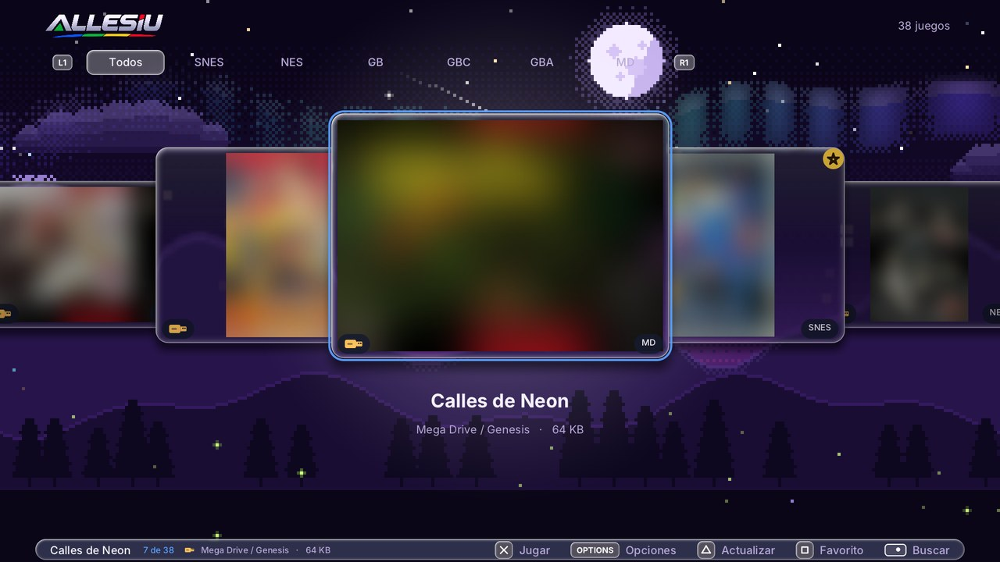

# ALLESIU — emulador de consolas clásicas para PS4

ALLESIU (antes SNESUI) es un emulador de consolas clásicas para la PS4 con GoldHEN. Empezó como un emulador de SNES
hecho desde cero, y ahora suma NES, Game Boy, Game Boy Color, GBA, Master System, Mega Drive, Game Gear, Neo Geo
Pocket, Neo Geo Pocket Color, Atari 7800, Atari Lynx y **arcade** (Neo Geo, CPS1, CPS2, CPS3 y cientos de placas más),
todo en la misma biblioteca, con interfaz en alta definición, carátulas automáticas, guardado de partidas, filtros de
imagen y música propia.

**Documentación:** [Guía completa con capturas](docs/GUIA.md) · [Carpetas: dónde va cada cosa](docs/CARPETAS.md) ·
[BIOS](docs/BIOS.md)

*En las capturas los nombres de los juegos son inventados y las carátulas están difuminadas a propósito.*

## Consolas

| Consola | Extensiones | Emulador |
|---|---|---|
| SNES | `.sfc` `.smc` `.fig` `.swc` | propio, hecho desde cero |
| NES / Famicom Disk System | `.nes` `.fds` `.unf` `.unif` | |
| Game Boy / Game Boy Color | `.gb` `.gbc` | |
| Game Boy Advance | `.gba` | |
| Master System | `.sms` | |
| Mega Drive / Genesis | `.md` `.gen` `.smd` `.bin` | |
| Game Gear | `.gg` | |
| Neo Geo Pocket / Color | `.ngp` `.ngc` `.ngpc` | |
| Atari 7800 | `.a78` | |
| Atari Lynx | `.lnx` | |
| Arcade: Neo Geo, CPS1, CPS2, CPS3 y otras placas | `.zip` `.7z` | |

- **ROMs comprimidas:** las ROMs pueden estar sueltas o en `.zip`, `.7z` o `.rar`.
- **Juegos de varias consolas juntos:** ALLESIU busca en todo el USB, incluidas las subcarpetas, y reconoce la consola
  por la extensión. Si un comprimido está en una carpeta con el nombre de la consola (por ejemplo `GBA`, `roms-gba` o
  `Game Boy Advance`), la búsqueda es más rápida porque no hace falta abrirlo.
- **Velocidad:** todos los emuladores corren a la velocidad de la consola original; la SNES va sin recompilador (JIT).

### Arcade

- Cada juego es un zip con el nombre corto del set (el que usa FinalBurn Neo). ALLESIU lo reconoce solo, muestra su
  título completo y lo ordena en su pestaña: **Neo Geo**, **CPS1**, **CPS2**, **CPS3** o **Arcade** (las demás placas).
- Los sets tienen que ser de la versión de FinalBurn Neo que lleva ALLESIU. Antes de abrir un juego se revisan sus
  archivos: si falta alguno, si es de otra versión o si falta la BIOS, ALLESIU avisa exactamente qué falta.
- Las versiones alternativas (clones) necesitan el zip del juego original en la misma carpeta, y los de Neo Geo, la
  BIOS `neogeo.zip` (en la misma carpeta, en cualquier parte del USB o en `/data/allesiu/bios/`). Al copiar un juego a la consola se copian
  también esos zips.
- `herramientas/reparar_arcade.py` rearma tus sets para esta versión: busca cada archivo por su huella (CRC) en todas
  las carpetas que le indiques y arma zips completos ("non-merged").

## Qué tiene

- **Biblioteca.** Una pestaña por consola (más Todos, Recientes, Favoritos y Configuración), fondo pixel art animado y
  búsqueda por nombre. Los juegos van apareciendo mientras se revisa el USB; la lista se guarda en un índice, así que
  la próxima vez aparece al instante y solo se revisan los archivos nuevos. Hasta 30.000 juegos.
- **Estilos.** 21 interfaces (L2), 12 formas de menú (R2) y 50 estilos de botones (○). Por defecto, *Aero clásico*:
  cajas de vidrio transparente con reflejo en los bordes sobre el paisaje pixel art.
- **Primera vez.** Un asistente explica dónde poner los juegos, las BIOS y las carátulas, y elige los ajustes básicos.
  Al actualizar se muestran las novedades, y al conectar un USB ALLESIU lo revisa solo.
- **Carátulas.** Se bajan solas desde la base de RetroArch cuando la consola tiene internet, aunque el nombre del
  archivo no sea exacto. También se copian las que ya tengas en el USB (formatos de RetroArch, ES-DE y Batocera) y se
  puede elegir una a mano entre las más parecidas del servidor, o quitarla.
- **Descripciones.** Si junto a tus juegos hay un `gamelist.xml` (de Batocera, ES-DE o un programa de datos), las
  vistas de lista muestran la descripción, el año, el género y los jugadores.
- **BIOS reconocidas por su contenido.** Con cualquier nombre y en cualquier carpeta del USB: ALLESIU las encuentra y
  las copia a la consola. En *Configuración → BIOS* se ve cuáles hay y cuáles faltan.
- **Trucos.** Archivos `.cht` de RetroArch, cada truco se activa o desactiva desde el menú de pausa.
- **Continuar donde quedaste.** Al salir de un juego se guarda su estado y al volver a abrirlo sigue ahí (se puede
  desactivar). Las ranuras de estado se pueden bloquear para no pisarlas sin querer.
- **Bezels.** Una imagen decorativa en las franjas que deja libres la imagen del juego.
- **Run-ahead.** Menos retraso entre el mando y la pantalla.
- **Copia de seguridad.** Partidas, favoritos, recientes y ajustes al USB (`ALLESIU-respaldo/`) y de vuelta.
- **Guardado.** La batería del cartucho se guarda sola (en la SNES, `.srm` compatible con snes9x y bsnes) y hay 4
  ranuras de estado rápido por juego, cada una con miniatura.
- **Imagen.** Proporción como la consola original, píxeles cuadrados, píxel exacto o 16:9; filtros suave, nítido,
  nítido suavizado, líneas de TV, CRT y **HD** (escalado de bordes al estilo xBR, que redondea las diagonales de los
  sprites). Configuración general, propia por consola y propia por juego.
- **Música.** Diez canciones originales de ALLESIU, compuestas y sintetizadas por el propio programa al estilo de los
  chips de sonido de las consolas, suenan en orden aleatorio en la biblioteca y se apagan solas al jugar. L3 pasa a la
  siguiente; se puede desactivar en Configuración.
- **Avance rápido y rebobinar.** R2 acelera hasta ×4 y L2 vuelve atrás en el tiempo.
- **Dos jugadores.** Con un segundo mando.
- **Juegos en el USB o en la consola.** Se pueden copiar a la consola o al USB uno por uno, todos juntos o
  automáticamente; siempre se deja 1 GB libre para el sistema y cada copia se verifica.
- **Diagnóstico automático.** Si un juego falla, ALLESIU lo detecta y guarda un informe en el USB, en
  `ALLESIU-diagnostico/`. No incluye datos personales.

### Capturas

| | |
|---|---|
|  |  |
|  |  |
|  |  |

Más en la [guía](docs/GUIA.md).

### SNES

El emulador de SNES es propio y se compara cuadro por cuadro con bsnes:

- en una colección de 762 juegos, el 90 % se ve idéntico a bsnes durante los primeros 30 segundos y ninguno se cuelga;
- están los 8 modos de video (modo 7, alta resolución, transparencias, ventanas, mosaico, HDMA, entrelazado) y el
  sonido completo con eco;
- chips especiales: **Super FX** (con aceleración ×2 a ×4), **SA-1**, **DSP-1**, **DSP-2**, **ST010**, **Cx4**,
  **S-DD1**, **SPC7110** (con su reloj) y **OBC1**. Los chips que no traen su programa en la rom se emulan con tablas
  calculadas por fórmula: no hace falta ningún archivo de firmware.

Todavía no funcionan los juegos con DSP-3, DSP-4, ST011 y ST018.

## Requisitos

- PS4 con **GoldHEN**. Está probado en el firmware 9.00.
- Tus propias ROMs. **No se incluye ninguna ROM ni ninguna BIOS.**

### BIOS (opcionales salvo Atari Lynx, Famicom Disk System y Neo Geo)

Detalles, nombres y CRC de cada una en **[docs/BIOS.md](docs/BIOS.md)**. Déjalas en cualquier parte del USB (por ejemplo en `bios/`): ALLESIU las reconoce por su contenido, aunque tengan otro
nombre, y las copia a `/data/allesiu/bios/` en la consola.

| Archivo | Para |
|---|---|
| `lynxboot.img` | Atari Lynx (**obligatoria**) |
| `disksys.rom` | juegos de Famicom Disk System |
| `gba_bios.bin` | GBA (opcional: sin ella se usa una BIOS propia del emulador) |
| `bios_MD.bin`, `bios_U.sms`, `bios_E.sms`, `bios_J.sms`, `bios.gg` | pantallas de arranque de Sega (opcionales) |
| `7800 BIOS (U).rom`, `7800 BIOS (E).rom` | Atari 7800 (opcionales: americana y europea) |
| `neogeo.zip` | arcade Neo Geo (**obligatoria** para esos juegos; también puede ir junto a los juegos) |

## Instalación

1. Descarga el PKG desde la sección [Releases](../../releases).
2. Cópialo a un USB y, en la PS4, instálalo con GoldHEN (*Ajustes de depuración → Instalador de paquetes*).
3. Copia tus ROMs al USB y abre **ALLESIU**. Pueden ir en cualquier carpeta, pero lo más ordenado es una carpeta por
   consola dentro de `roms/`, con los nombres de Batocera y ES-DE: `roms/snes`, `roms/nes`, `roms/gb`, `roms/gbc`,
   `roms/gba`, `roms/megadrive`, `roms/mastersystem`, `roms/gamegear`, `roms/ngp`, `roms/ngpc`, `roms/atari2600`,
   `roms/atari7800`, `roms/lynx`, `roms/arcade`, `roms/neogeo`, `roms/cps1`, `roms/cps2`, `roms/cps3`.

En el USB también se pueden dejar, opcionalmente:

- `caratulas/` (o las carpetas de carátulas de RetroArch, ES-DE o Batocera);
- `trucos/<consola>/` o `cheats/` con archivos `.cht`;
- `bezels/<consola>/<juego>.png`, `bezels/<consola>/default.png` o `bezels/<consola>.png`.

## Controles

| En la biblioteca | |
|---|---|
| ✕ | Jugar |
| △ | Actualizar (volver a revisar el USB) |
| □ | Agregar o quitar de favoritos |
| OPTIONS | Opciones del juego: copiar a la consola o al USB, borrar, elegir la carátula, bajar las que faltan, copiar o borrar todos |
| Panel táctil | Buscar por nombre (teclado en pantalla); ○ quita la búsqueda |
| L1 / R1 | Cambiar de pestaña: Todos, cada consola, Recientes, Favoritos, Configuración |
| L2 / R2 | Cambiar la interfaz / la forma del menú |
| ○ | Cambiar el estilo de los botones |
| R3 | Un juego al azar |
| L3 | La canción siguiente |
| Stick derecho ← → | Saltar a la letra anterior o siguiente |

| Jugando | |
|---|---|
| ✕ ○ □ △ | Los botones de la consola (en la SNES: B A Y X; en las de dos botones, ✕/□ y ○/△) |
| L1 / R1 | L / R |
| OPTIONS | Start |
| Panel táctil | Select |
| **R2** (mantener) | Avance rápido |
| **L2** (mantener) | Rebobinar |
| **L3 + R3** | Menú de pausa: guardar o cargar estado, trucos, proporción, filtro, reiniciar, salir |

**Dos jugadores:** inicia sesión con un segundo usuario de la PS4 en el otro mando; ALLESIU lo detecta solo.

## Dónde guarda las cosas

Todos los detalles (carátulas, trucos, bezels, copia de seguridad) en **[docs/CARPETAS.md](docs/CARPETAS.md)**.

Todo queda en `/data/allesiu/` en la consola (lo de versiones anteriores, en `/data/snes-ps4/`, se muda solo la
primera vez):

- `roms/<consola>/`: los juegos copiados desde el USB, cada uno en la carpeta de su consola;
- `guardados/`: las partidas y los estados rápidos (las consolas que no son la SNES, en `guardados/<consola>/`);
- `caratulas/`: las carátulas;
- `bios/`: las BIOS;
- `trucos/<consola>/` y `bezels/`: trucos y bezels propios (también se leen del USB);
- `biblioteca.txt`, `metadatos.txt`: el índice de la biblioteca y las descripciones leídas de los `gamelist.xml`;
- `ajustes.txt`, `ajustes_consolas.txt`: la configuración general y la propia de cada consola.

## Compilar

Se compila en Windows con Git Bash:

- **Toolchain:** [OpenOrbis PS4 Toolchain](https://github.com/OpenOrbis/OpenOrbis-PS4-Toolchain) v0.5.3 y
  LLVM/clang 18.
- **Emuladores de las otras consolas:** se bajan aparte (ver `src/nucleos/nucleos.sh`, que los compila desde
  `C:\ps4dev\externos`).
- **PKG:** `sh construir.sh` deja los PKG en `salida/`.
- **Herramientas de PC:** `sh pc/compilar.sh` compila el simulador de la interfaz y los probadores.

Hay detalles importantes para que el programa abra en la consola: sin excepciones de C++, sin RTTI, sin constructores
globales y sin tablas constantes grandes de punteros. Están explicados en `construir.sh` y `src/nucleos/nucleos.sh`, y
`herramientas/revisar_elf.py` revisa cada ejecutable antes de probarlo.

## Créditos

Emuladores de otras consolas que usa ALLESIU:

- [FCEUmm](https://github.com/libretro/libretro-fceumm) (NES), del equipo de FCEU/FCE Ultra y libretro.
- [Gambatte](https://github.com/libretro/gambatte-libretro) (Game Boy y Game Boy Color), de Sindre Aamås y libretro.
- [mGBA](https://github.com/mgba-emu/mgba) (Game Boy Advance), de Vicki Pfau.
- [Genesis Plus GX](https://github.com/libretro/Genesis-Plus-GX) (Mega Drive, Master System y Game Gear), de Eke-Eke
  y Charles MacDonald.
- [Beetle NeoPop](https://github.com/libretro/beetle-ngp-libretro) (Neo Geo Pocket), basado en NeoPop de neopop_uk y
  Mednafen.
- [ProSystem](https://github.com/libretro/prosystem-libretro) (Atari 7800), de Greg Stanton.
- [Handy](https://github.com/libretro/libretro-handy) (Atari Lynx), de Keith Wilkins.
- [FinalBurn Neo](https://github.com/finalburnneo/FBNeo) (arcade), del equipo de FinalBurn Neo, basado en FinalBurn
  de Dave y FinalBurn Alpha.
- [miniz](https://github.com/richgel999/miniz), el [LZMA SDK](https://www.7-zip.org/sdk.html) de Igor Pavlov y
  [dmc_unrar](https://github.com/DrMcCoy/dmc_unrar), para las ROMs comprimidas.

Además:

- Carátulas: [libretro-thumbnails](https://github.com/libretro-thumbnails/libretro-thumbnails) (RetroArch).
- Letra Inter (en `assets/`).
- [stb](https://github.com/nothings/stb), para PNG y letras.
- Documentación del hardware de la SNES: fullsnes (nocash). Comparación de exactitud: snes9x y bsnes. Pruebas de
  hardware de [PeterLemon](https://github.com/PeterLemon/SNES).

ALLESIU no tiene relación con Nintendo, Sega, SNK, Atari ni Capcom. Los nombres de las consolas son marcas de sus dueños. Usa
solo ROMs y BIOS de juegos y consolas que tengas.

Creado por **RudolphGamerBkn**.
