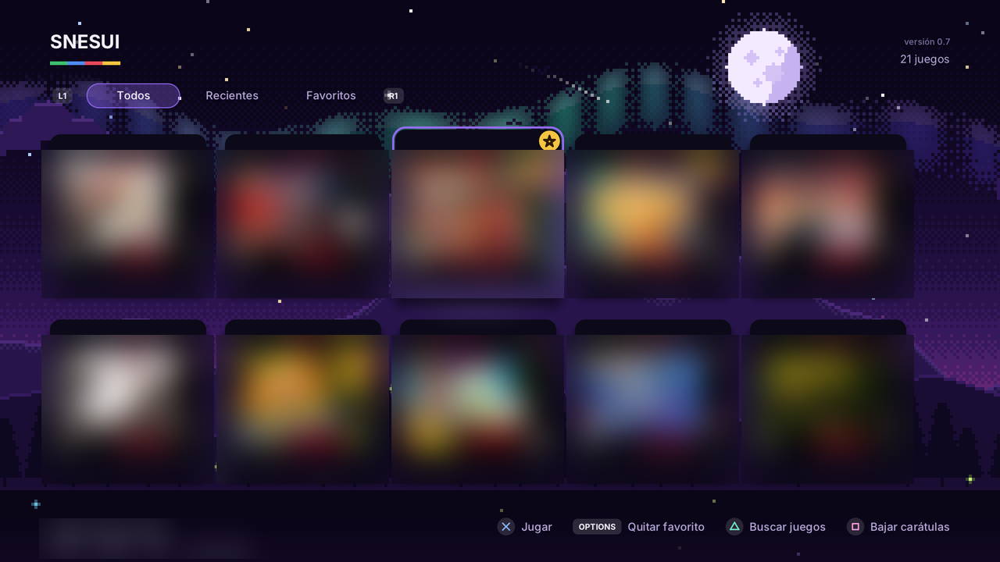
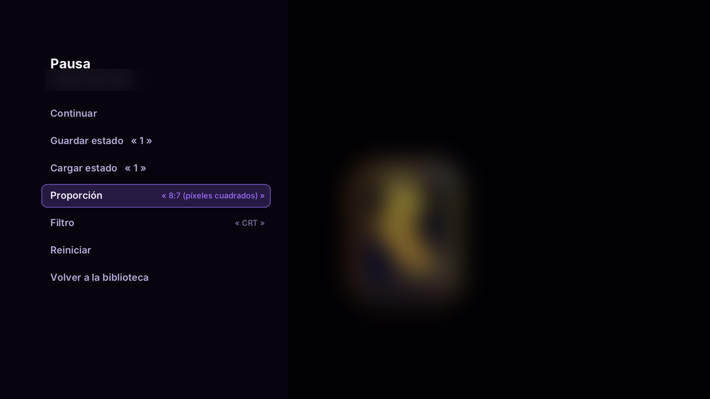

# SNESUI — emulador de Super Nintendo para PS4

SNESUI es un emulador de Super Nintendo (SNES) hecho desde cero para la PS4 con GoldHEN. Tiene una interfaz en alta
definición, carátulas automáticas, guardado de partidas y filtros de imagen.

## Qué tiene

- **Emulación fiel.** Los gráficos, el sonido y el ritmo de la consola se compararon cuadro por cuadro con snes9x y
  bsnes:
  - en partidas largas, el juego sigue el mismo recorrido que en snes9x;
  - 51 de 61 pruebas de hardware dan la misma imagen que bsnes.
- **Gráficos completos.** Están los 8 modos de video:
  - modo 7 (rotación y zoom);
  - alta resolución;
  - transparencias y mezcla de colores;
  - ventanas, mosaico y HDMA (degradados y efectos por línea);
  - entrelazado.
- **Sonido completo.** Están el procesador de sonido y el DSP, con eco.
- **Guardado.**
  - La batería del cartucho se guarda sola en `.srm`, compatible con snes9x y bsnes.
  - Hay 4 ranuras de estado rápido por juego, cada una con miniatura.
- **Carátulas automáticas.** Se bajan desde la base de RetroArch, aunque el nombre del archivo no sea exacto.
- **Configuración general y por juego.** La pestaña Configuración vale para todos los juegos; desde el menú de pausa
  cada juego puede tener su propia proporción y filtro.
- **Imagen.**
  - Proporción: 4:3, 8:7, píxel exacto o 16:9.
  - Filtros: suave, nítido, nítido suavizado, líneas de TV y CRT.
- **Avance rápido y rebobinar.** R2 acelera hasta ×4 y L2 vuelve atrás en el tiempo.
- **Dos jugadores.** Con un segundo mando.
- **Interfaz.** Biblioteca con fondo pixel art animado, pestañas de recientes y favoritos, y búsqueda de juegos en
  todo el USB, incluidas las subcarpetas.
- **Bibliotecas grandes.** Hasta 10.000 juegos: la lista aparece al instante (se guarda un índice), el USB se revisa
  en segundo plano analizando solo las ROMs nuevas, y se puede buscar por nombre.

## Requisitos

- PS4 con **GoldHEN**. Está probado en el firmware 9.00.
- Tus propias ROMs de SNES (`.sfc`, `.smc`, `.fig`, `.swc`). **No se incluye ninguna ROM.**

## Instalación

1. Descarga el PKG desde la sección [Releases](../../releases).
2. Cópialo a un USB y, en la PS4, instálalo con GoldHEN (*Ajustes de depuración → Instalador de paquetes*).
3. Copia tus ROMs en cualquier parte del USB y abre **SNESUI**.

Hay dos versiones del PKG:

- **SNESUI:** la normal.
- **SNESUI (segura):** no usa la red ni el listado de carpetas. Úsala si la normal no abre en tu consola. No baja
  carátulas.

## Controles

| En la biblioteca | |
|---|---|
| ✕ | Jugar |
| △ | Buscar juegos en el USB |
| □ | Bajar las carátulas que falten |
| OPTIONS | Marcar o quitar de favoritos (★) |
| L1 / R1 | Cambiar de pestaña: Todos, Recientes, Favoritos, Configuración |
| L2 / R2 | Subir o bajar una página |
| Stick derecho ← → | Saltar a la letra anterior o siguiente |
| Panel táctil | Buscar por nombre (teclado en pantalla); ○ quita la búsqueda |

| Jugando | Botón de la SNES |
|---|---|
| ✕ ○ □ △ | B A Y X |
| L1 / R1 | L / R |
| OPTIONS | Start |
| Panel táctil | Select |
| **R2** (mantener) | Avance rápido |
| **L2** (mantener) | Rebobinar (vuelve atrás en el tiempo) |
| **L3 + R3** | Menú de pausa: guardar o cargar estado, proporción, filtro, reiniciar, salir |

**Dos jugadores:** inicia sesión con un segundo usuario de la PS4 en el otro mando; SNESUI lo detecta solo y lo pone
como jugador 2.

## Dónde guarda las cosas

Todo queda en `/data/snes-ps4/` en la consola:

- `guardados/`: las partidas (`.srm`) y los estados rápidos (`.st0` a `.st3`);
- `caratulas/`: las carátulas bajadas;
- `biblioteca.txt`: el índice de la biblioteca (para que aparezca al instante; se actualiza solo);
- `ajustes.txt`: la configuración general (proporción, filtro, avance rápido, rebobinar);
- `guardados/<juego>.cfg`: la proporción y el filtro propios de un juego, si se cambiaron desde su menú de pausa.

## Estado actual

Todavía **no** funcionan los juegos con chips especiales en el cartucho:

- Super FX;
- SA-1;
- DSP-1;
- Cx4, S-DD1 y SPC7110.

Están planeados para próximas versiones.

## Compilar

Se compila en Windows con Git Bash:

- **Toolchain:** [OpenOrbis PS4 Toolchain](https://github.com/OpenOrbis/OpenOrbis-PS4-Toolchain) v0.5.3 y
  LLVM/clang 18.
- **PKG:** `sh construir.sh` deja los PKG en `salida/`. Si tu toolchain está en otra carpeta, define `PS4_TOOLCHAIN`
  (ruta de Git Bash), `PS4_TOOLCHAIN_WIN` (ruta de Windows) y `LLVM_BIN`.
- **Herramientas de PC:** `sh pc/compilar.sh` compila el simulador de la interfaz y los probadores del núcleo.

Hay detalles importantes para que el programa abra en la consola: sin excepciones de C++, sin RTTI y sin constructores
globales. Están explicados en `construir.sh`, y `herramientas/revisar_elf.py` revisa cada ejecutable antes de probarlo.

### Estructura

- `src/nucleo/`: el emulador:
  - `cpu.cpp`: procesador 65816;
  - `ppu.cpp`: gráficos;
  - `apu.cpp`, `spc700.inc`, `dsp.inc`: sonido;
  - `bus.cpp`: memoria, DMA y HDMA.
- `src/app/`: la interfaz (biblioteca, juego, carátulas, fondo animado).
- `src/comun/`: dibujo en HD por software, texto y acceso a la PS4.
- `pc/`: simulador y pruebas en PC.

## Créditos

- Carátulas: [libretro-thumbnails](https://github.com/libretro-thumbnails/libretro-thumbnails) (RetroArch).
- Letra Inter, licencia OFL (en `assets/`).
- [stb](https://github.com/nothings/stb) (dominio público), para PNG y letras.
- Documentación del hardware: fullsnes (nocash).
- Comparación de exactitud: snes9x y bsnes.
- Pruebas de hardware de [PeterLemon](https://github.com/PeterLemon/SNES).

SNESUI no tiene relación con Nintendo. Super Nintendo es marca de Nintendo. Usa solo ROMs de juegos que tengas.

Creado por **RudolphGamerBkn**. © RudolphGamerBkn. Todos los derechos reservados.
