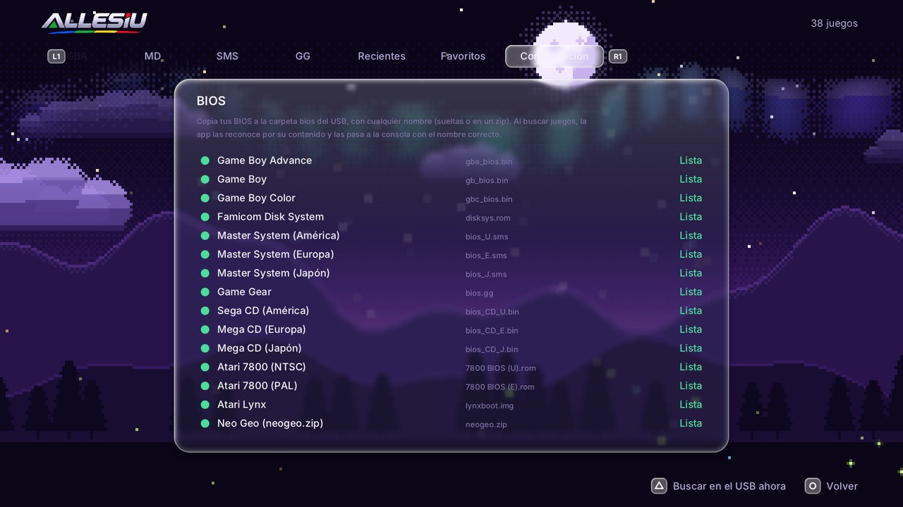

# BIOS

Una BIOS es el programa de arranque de la consola original. **ALLESIU no incluye ninguna**: tienen derechos de autor y
tienes que sacarlas de tu propia consola.

Casi todas son **opcionales**: sin ellas los juegos funcionan igual (los emuladores traen un reemplazo) y solo se pierde
la pantalla de arranque original. Las únicas obligatorias son las de **Atari Lynx**, **Famicom Disk System** y
**Neo Geo**.

## Cómo se instalan

No hace falta renombrarlas ni ponerlas en una carpeta exacta:

1. Copia tus BIOS **en cualquier parte del USB** (lo más ordenado es una carpeta `bios/`). Pueden estar sueltas y
   también dentro de otras carpetas.
2. Abre ALLESIU (o pulsa △ para volver a revisar el USB).
3. ALLESIU revisa el **contenido** de cada archivo (su tamaño y su huella CRC-32): reconoce las BIOS aunque tengan otro
   nombre y las copia a `/data/allesiu/bios/` en la consola con el nombre correcto. Desde ahí funcionan aunque saques
   el USB.

En *Configuración → BIOS* se ve cuáles están (✓), cuáles faltan y si alguna es de otra versión:

## Las que reconoce

| Consola | Archivo | CRC-32 | ¿Obligatoria? |
|---|---|---|---|
| Atari Lynx | `lynxboot.img` | `0d973c9d` | **Sí** |
| Famicom Disk System | `disksys.rom` | `5e607dcf` | **Sí** (para los juegos `.fds`) |
| Neo Geo | `neogeo.zip` | se reconoce por los archivos de adentro (`000-lo.lo`, `sfix.sfix`) | **Sí** (para Neo Geo) |
| Game Boy Advance | `gba_bios.bin` | `81977335` | No (sin ella se usa una BIOS propia del emulador) |
| Game Boy | `gb_bios.bin` | `59c8598e` | No |
| Game Boy Color | `gbc_bios.bin` | `41884e46` | No |
| Master System (América) | `bios_U.sms` | `0072ed54` | No |
| Master System (Europa) | `bios_E.sms` | `0072ed54` | No |
| Master System (Japón) | `bios_J.sms` | `48d44a13` | No |
| Game Gear | `bios.gg` | `0ebea9d4` | No |
| Atari 7800 (NTSC) | `7800 BIOS (U).rom` | `5d13730c` | No |
| Atari 7800 (PAL) | `7800 BIOS (E).rom` | `d5b61170` | No |
| Sega CD / Mega CD (América, Europa, Japón) | `bios_CD_U.bin`, `bios_CD_E.bin`, `bios_CD_J.bin` | `9f6f6276`, `529ac15a`, `9d2da8f2` | Se reconocen y se guardan; Sega CD todavía no está |

Son los mismos archivos (mismo nombre y CRC) que pide RetroArch, así que si ya tienes tu carpeta `system/` de
RetroArch, copiarla al USB alcanza.

## Si algo no anda

- **"Falta la BIOS" al abrir un juego de Neo Geo:** el `neogeo.zip` tiene que ser el set de BIOS de FinalBurn Neo (con
  `000-lo.lo` y `sfix.sfix` adentro). También puede ir en la misma carpeta que los juegos.
- **Una BIOS aparece como "distinta":** el archivo tiene el nombre correcto pero otro contenido (otra versión o un
  archivo dañado). Los emuladores pueden no aceptarla.
- **No aparece después de copiarla:** pulsa △ en la biblioteca para volver a revisar el USB.
