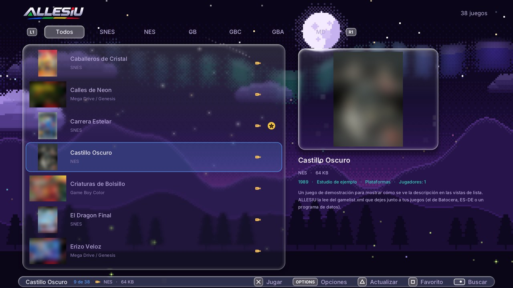

# Carpetas: dónde poner cada cosa

ALLESIU revisa **todo el USB** (y la carpeta de juegos de la consola), así que los juegos funcionan estén donde
estén. Pero si usas una carpeta por consola todo es más rápido y ordenado, y la app sabe de qué consola es cada juego
sin tener que adivinar.

## En el USB

```
USB/
├── roms/
│   ├── snes/            juegos de SNES (.sfc .smc .fig .swc, también dentro de .zip o .7z)
│   ├── nes/             NES y Famicom Disk System (.nes .fds .unf)
│   ├── gb/  gbc/  gba/
│   ├── megadrive/       Mega Drive / Genesis (.md .gen .smd .bin)
│   ├── mastersystem/  gamegear/
│   ├── ngp/  ngpc/      Neo Geo Pocket y Pocket Color
│   ├── atari2600/  atari7800/  lynx/
│   ├── arcade/          juegos de arcade (zip de FinalBurn Neo)
│   ├── neogeo/  cps1/  cps2/  cps3/
│   └── <consola>/gamelist.xml   (opcional) descripciones, año, género y jugadores
├── bios/                (opcional) las BIOS: ver BIOS.md
├── caratulas/           (opcional) tus carátulas: caratulas/<consola>/<juego>.png
├── trucos/              (opcional) trucos .cht: trucos/<consola>/<juego>.cht
├── bezels/              (opcional) marcos decorativos
└── ALLESIU-diagnostico/ (lo crea la app) informes si un juego falla
```

### Nombres de las carpetas de consola

Son los mismos nombres cortos que usan **Batocera** y **ES-DE**, así que si ya tienes tus juegos ordenados para esos
programas, el USB sirve tal cual. También se reconocen otros nombres comunes:

| Consola | Carpeta | También sirve |
|---|---|---|
| SNES | `snes` | `sfc`, `supernintendo`, `superfamicom`, `supernes` |
| NES | `nes` | `famicom`, `fds` |
| Game Boy | `gb` | `gameboy` |
| Game Boy Color | `gbc` | `gameboycolor` |
| Game Boy Advance | `gba` | `gameboyadvance` |
| Mega Drive / Genesis | `megadrive` | `md`, `genesis` |
| Master System | `mastersystem` | `sms` |
| Game Gear | `gamegear` | `gg` |
| Neo Geo Pocket / Color | `ngp`, `ngpc` | `neogeopocket`, `neogeopocketcolor` |
| Atari 2600 / 7800 | `atari2600`, `atari7800` | `2600`, `a2600`, `7800`, `a7800` |
| Atari Lynx | `lynx` | `atarilynx` |
| Arcade | `arcade` | `mame`, `fbneo`, `fba`, `finalburn`, `finalburnneo` |
| Neo Geo, CPS1, CPS2, CPS3 | `neogeo`, `cps1`, `cps2`, `cps3` | |

Da igual si las carpetas están en `roms/` o directamente en la raíz del USB, y si llevan mayúsculas.

### Juegos de arcade

- Cada juego es un **zip con el nombre corto de FinalBurn Neo** (el que usa RetroArch). Si tus zips tienen el título
  completo, ALLESIU igual los reconoce por las huellas (CRC) de los archivos de adentro.
- Las **versiones alternativas** (clones) necesitan el zip del juego original en la misma carpeta.
- Los juegos de **Neo Geo** necesitan `neogeo.zip` (en `bios/`, junto a los juegos o en la consola).
- Si a un juego le falta algo, la etiqueta de la consola se ve en ámbar y, al abrirlo, ALLESIU **dice exactamente qué
  falta**.

### Descripciones (`gamelist.xml`)

Si junto a tus juegos hay un `gamelist.xml` (el que arman Batocera, ES-DE o programas como Skraper), ALLESIU lee de
ahí la **descripción, el año, el desarrollador, el género y los jugadores**, y los muestra en las vistas *Lista* y
*Lista detallada*.



## Carátulas

ALLESIU consigue las carátulas de tres formas:

1. **Solas, por internet.** Si la consola tiene conexión, al terminar de revisar el USB se bajan las que falten desde
   la base de RetroArch (*Configuración → Bajar carátulas automáticamente*). Al principio el contador puede quedarse unos
   segundos en 0 mientras se baja la lista de nombres de cada consola.
2. **Desde tu USB.** Si ya tienes carátulas, se copian solas a la consola. Sirven estas carpetas:

   | Programa | Carpeta en el USB |
   |---|---|
   | ALLESIU | `caratulas/<consola>/<juego>.png` (también `covers/` o `boxart/`) |
   | RetroArch | `thumbnails/<Sistema>/Named_Boxarts/` (por ejemplo `Nintendo - Game Boy Advance`) |
   | ES-DE | `downloaded_media/<consola>/covers/` |
   | Batocera | `roms/<consola>/images/<juego>-thumb.png` (también `-image` o `-boxart`) |

   El nombre de la imagen se compara solo por letras y números, así que no importan los espacios, guiones o signos.
   Sirven `.png` y `.jpg`.
3. **A mano.** En las opciones del juego (OPTIONS) → *Elegir la carátula…* aparecen las más parecidas del servidor
   para elegir una, o quitar la que tiene.

## Trucos

Archivos `.cht` de RetroArch. ALLESIU los busca, para cada juego, en:

- `trucos/<consola>/` del USB o de la consola (`/data/allesiu/trucos/<consola>/`);
- `cheats/<consola>/` o `cheats/<Sistema de RetroArch>/` del USB (la carpeta de trucos de RetroArch, tal cual).

El archivo debe llamarse como el juego (`<juego>.cht`). Los trucos se activan uno por uno desde el **menú de pausa**
(L3 + R3 → *Trucos*) y ALLESIU recuerda cuáles dejaste activos.

## Bezels (marcos decorativos)

Una imagen de 1920 × 1080 que se ve en las franjas que deja libres la imagen del juego, en lugar del negro. Se busca,
en este orden, en el USB y en `/data/allesiu/`:

1. `bezels/<consola>/<juego>.png` (para un juego),
2. `bezels/<consola>/default.png` (para toda la consola),
3. `bezels/<consola>.png`.

También sirven en `.jpg`. Se activan en *Configuración → Marcos decorativos (bezels)*.

## En la consola: `/data/allesiu/`

Todo lo que ALLESIU guarda en la PS4. Lo de versiones anteriores (`/data/snes-ps4/`) se muda solo la primera vez.

| Carpeta o archivo | Qué hay |
|---|---|
| `roms/<consola>/` | Los juegos copiados desde el USB, cada uno en la carpeta de su consola |
| `guardados/` | Partidas (`.srm`), estados rápidos (`.st0` a `.st3`, con miniatura) y el estado de *Continuar*; las consolas que no son la SNES, en `guardados/<consola>/` |
| `caratulas/<consola>/` | Las carátulas |
| `bios/` | Las BIOS |
| `trucos/<consola>/`, `bezels/` | Trucos y bezels propios |
| `biblioteca.txt` | El índice de la biblioteca (para que aparezca al instante) |
| `metadatos.txt` | Las descripciones leídas de los `gamelist.xml` |
| `favoritos.txt`, `recientes.txt` | Tus listas |
| `ajustes.txt`, `ajustes_consolas.txt` | La configuración general y la propia de cada consola |

### Copia de seguridad

*Configuración → Respaldar partidas al USB* guarda las partidas, los favoritos, los recientes y los ajustes en
`ALLESIU-respaldo/` del USB. *Restaurar el respaldo del USB* los devuelve (por ejemplo, después de reinstalar o en otra PS4).


